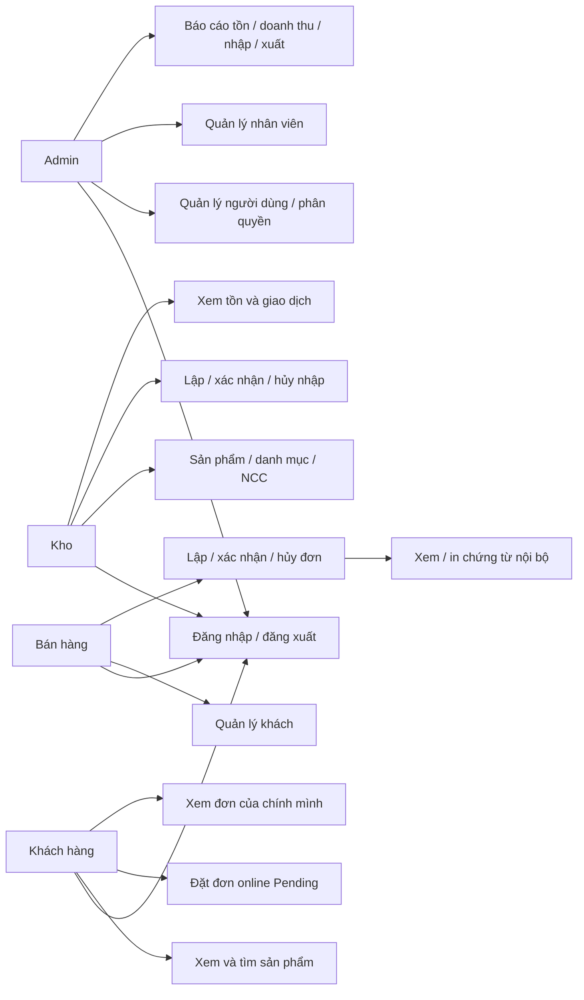
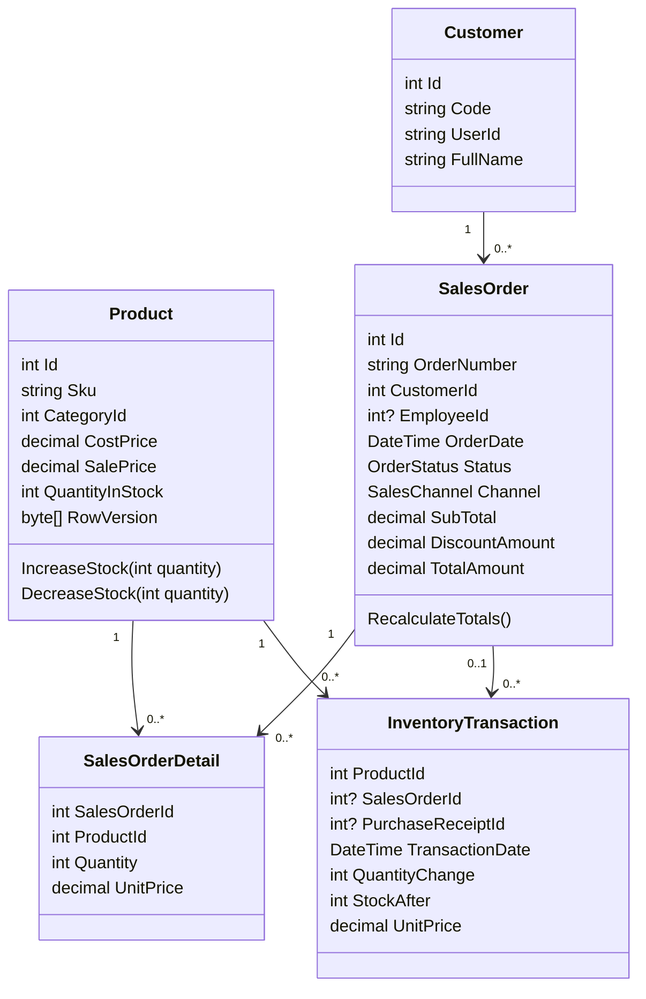
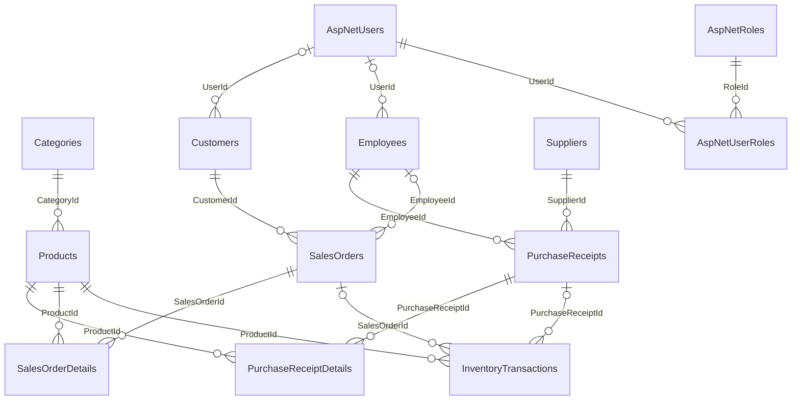

# Phân tích và thiết kế CNTT_DACN_05

## Bối cảnh, mục tiêu và phạm vi

Đề tài xây dựng hệ thống bán hàng trực tuyến phục vụ đồ án chuyên ngành Khoa CNTT, HUIT. Nhu cầu được mô hình hóa là quản lý danh mục, đối tác, nhập/xuất, tồn và đơn bán tại quầy/trực tuyến trong cùng một cơ sở dữ liệu. Mục tiêu kỹ thuật: lưu vết biến động kho, kiểm soát quyền, lưu giá tại thời điểm đặt hàng và cung cấp báo cáo có định nghĩa rõ ràng.

Đây là **mô hình doanh nghiệp giả định**, chưa có chứng cứ khảo sát doanh nghiệp thực tế. Không sử dụng số liệu mẫu để suy ra hiệu quả kinh doanh thực tế. Phạm vi một kho, một tiền tệ; chưa có thuế điện tử, cổng thanh toán, giao vận, nhiều kho, trả hàng hoàn tất hoặc phân hệ ca trực nâng cao.

## Cơ cấu tổ chức giả định

Chủ cửa hàng/quản trị hệ thống (Admin) quản lý tài khoản, nhân viên và báo cáo; bộ phận kho (Kho) quản lý hàng hóa, NCC và nhập kho; bộ phận bán hàng (BanHang) quản lý khách và đơn; khách hàng đăng nhập sử dụng cửa hàng trực tuyến. Đây là phân công thiết kế, cần xác nhận nếu khảo sát thực tế.

## Quy trình và quy định

1. Nhập: lập Draft có NCC/nhân viên → thêm các dòng sản phẩm → kiểm tra → Confirmed; chỉ xác nhận mới tăng tồn và thêm giao dịch. Xác nhận trùng bị từ chối. Hủy theo quy tắc service; không cho hủy đã nhập nếu không đủ tồn để đảo giao dịch.
2. Bán: Counter hoặc Online → Pending chứa giá sản phẩm lấy từ server → nhân viên xác nhận → trừ tồn và ghi lịch sử → xem/in chứng từ nội bộ. Pending chưa giữ/trừ tồn nên khả năng còn hàng phải kiểm tra lại khi xác nhận.
3. Hủy: Pending không động tồn; Confirmed hoàn tồn đúng một lần; Completed không hủy trực tiếp, cần quy trình trả hàng riêng ngoài phạm vi.
4. Tồn: Product.QuantityInStock là số dư hiện tại; InventoryTransaction là sổ thay đổi có dấu. Mỗi thay đổi kho đi qua service trong transaction; CRUD sản phẩm không sửa số dư.
5. Hóa đơn: chỉ đơn Confirmed/Completed; chứng từ bán hàng nội bộ, không tuyên bố là hóa đơn điện tử hợp pháp. PaymentStatus là trạng thái mô phỏng, không là bằng chứng đã nhận tiền ngân hàng.
6. Báo cáo doanh thu: tổng TotalAmount của đơn hiện Confirmed/Completed theo OrderDate; tách Counter/Online. Báo cáo nhập/xuất: ngày TransactionDate, đơn giá UnitPrice và số lượng giao dịch, chỉ chứng từ hiện còn hiệu lực. Việc hủy sau ngày báo cáo có thể làm thay đổi báo cáo chứng từ còn hiệu lực; muốn chốt lịch sử phải dùng sổ biến động ròng và quy trình khóa kỳ ngoài phạm vi hiện tại.

## Use case nghiệp vụ

Admin có quyền các chức năng kho/bán theo attributes thực tế; sơ đồ chỉ vẽ các nhóm nhiệm vụ chính để dễ đọc.

## Use case hệ thống và đặc tả trọng yếu

| Use case | Tiền điều kiện | Luồng chính | Ngoại lệ / hậu điều kiện |
|---|---|---|---|
| Đăng nhập | Tài khoản Identity | Kiểm tra mật khẩu, tạo cookie | Sai mật khẩu tăng bộ đếm; khóa tạm theo IdentityConfig |
| Cấp role | Admin đã xác thực | Chọn user và role cho phép, cập nhật SecurityStamp | Không gỡ chính mình/last Admin; không nhận role tùy ý |
| CRUD hàng hóa | Admin/Kho | Validate, kiểm tra trùng/FK, SaveChanges | Không sửa tồn; conflict RowVersion báo tải lại |
| Nhập kho | Draft hợp lệ | Khóa phiếu/sản phẩm, kiểm tra trạng thái, tăng tồn, ledger, commit | Lỗi rollback toàn bộ, không tăng hai lần |
| Xuất kho | Pending hợp lệ | Khóa đơn/sản phẩm, kiểm tra đủ tồn, trừ, ledger, commit | Vượt tồn/đơn đã xử lý bị từ chối |
| Đặt online | Đăng nhập, hồ sơ hoạt động | Chọn hàng, nhập người nhận, server tính giá, Pending | Không nhận CustomerId/giá/status từ client; token session chống gửi lặp |
| Xem đơn cá nhân | Đăng nhập | Lọc Customer.UserId theo Identity hiện tại | Đơn người khác trả 404 |
| Thanh toán | Đơn có phương thức/trạng thái | Hiển thị thông tin mô phỏng trong đơn/chứng từ | Không tích hợp thu tiền thật; không đồng nhất doanh thu với tiền thu |
| Báo cáo | Role tương ứng | Validate ngày, lọc chứng từ, tổng hợp, in | Không dữ liệu/ngày sai phải hiển thị rõ; cần test A4 thực tế |

## Lớp nghiệp vụ chính theo source

Không có lớp Inventory độc lập trong source: khái niệm tồn được biểu diễn bởi Product.QuantityInStock và InventoryTransaction. Không tạo lớp giả để khớp tên trong đề cương.

## ERD phần nghiệp vụ đang sử dụng

FK Customer.UserId hiện không unique: ERD phản ánh one-to-many thực tế, không khẳng định mỗi user chỉ có một hồ sơ ở cấp DB. Checkout chặn trường hợp có nhiều hồ sơ. Quy tắc giao dịch không được gắn cả phiếu nhập và đơn bán được validation model/service kiểm soát.

## Thiết kế chi tiết và truy vết

Controller kiểm tra quyền/token/input → ViewModel/Input DTO → service nghiệp vụ → ApplicationDbContext/EF6 → SQL Server. Services/PurchaseReceiptService.cs và SalesOrderService.cs giữ giao dịch Serializable, khóa UPDLOCK/HOLDLOCK, kiểm tra trạng thái và ledger trước commit. Product.RowVersion xử lý optimistic concurrency trong CRUD.

Danh sách thuộc tính đầy đủ lấy trực tiếp từ Models/*.cs, các ràng buộc quan hệ từ OnlineSalesModelConfiguration.cs và migrations. Các lớp chuẩn bị ca trực (WorkShift, ShiftTemplate, InventoryShiftSnapshot/Detail, InventoryShiftOpeningStock, InventoryShiftAuditLog) vẫn giữ nguyên, chưa đưa vào use case triển khai. Cần sơ đồ chi tiết các lớp này nếu mở rộng phạm vi ở đợt sau, không tự thêm quan hệ User FK chỉ vì tên thuộc tính có UserId.

## Mẫu khảo sát cần điền

| Nội dung | Người cung cấp / ngày / bằng chứng | Thông tin cần xác minh |
|---|---|---|
| Cơ cấu và quyền | Chưa khảo sát | Ai lập, ai duyệt nhập/xuất; có phân tách nhiệm vụ không? |
| Danh mục và SKU | Chưa khảo sát | Quy tắc mã, đơn vị, ngừng kinh doanh, trùng mã |
| Phiếu nhập / NCC | Chưa khảo sát | Biểu mẫu thật, ngày chứng từ/ngày nhận, giá nhập |
| Bán hàng / hóa đơn | Chưa khảo sát | Chiết khấu, người nhận, trạng thái, hóa đơn pháp lý |
| Tồn và hủy/hoàn | Chưa khảo sát | Kiểm kê, giá vốn, xử lý lệch, hàng trả, khóa kỳ |
| Thanh toán | Chưa khảo sát | Tiền thu, đối soát, hoàn tiền, chứng từ ngân hàng |
| Báo cáo | Chưa khảo sát | Định nghĩa doanh thu, kỳ báo cáo, in/xuất và quyền |

Thu thập biểu mẫu đã ẩn dữ liệu cá nhân: phiếu nhập, phiếu xuất, đơn bán, chứng từ nội bộ, báo cáo tồn/doanh thu, bảng phân quyền. Ghi rõ nguồn, sự cho phép sử dụng, phiên bản và ngày thu thập; không bịa chữ ký, số liệu hoặc kết quả phỏng vấn.

## Sơ đồ lớp chi tiết

Xem [MODEL_CLASSES.mmd](MODEL_CLASSES.mmd): 16 model và navigation đơn thực tế. Mũi tên là navigation trong code, không suy ra cardinality hoặc FK mới. Ca trực chỉ chuẩn bị; chưa render sơ đồ. Luồng online bổ sung guard Identity UserId và token gắn owner/sản phẩm, chờ build/HTTP test.
